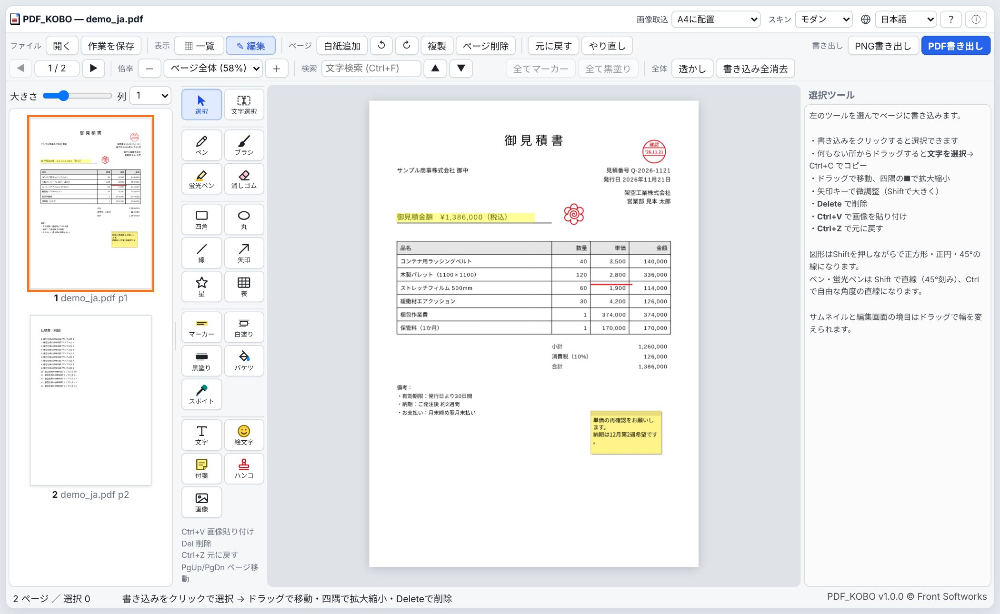

# Front PDF

**インストール不要・完全オフラインの PDF 編集ツール（HTML ファイル1つ）**
**A free, offline PDF editor in a single HTML file — no installation, nothing leaves your PC.**

🌐 公式ページ / Official page: **https://hiro0149.github.io/pdf-kobo/**
⬇ ダウンロード / Download: [Releases](https://github.com/Hiro0149/pdf-kobo/releases/latest)

> ⚠ **作者はメールでは配布しません。** 必ず公式ページまたは GitHub Releases から入手してください。人に勧めるときは、ファイルではなく公式ページの URL を教えてください。
> ⚠ **The author never distributes Front PDF by email.** Always download from the official page or GitHub Releases, and share the page URL rather than the file.



---

## 日本語

### 特長
- **HTML ファイル1つ**：ダブルクリックで Edge / Chrome で開くだけ。exe ではないので管理者権限も不要です。
- **外部と通信しない**：PDF はブラウザの中だけで処理します。アップロードもアクセス解析もありません。
- **できること**：結合・分割・並べ替え・回転、ペン・図形・表・文字・絵文字・画像、DocuWorks 風の付箋（PDF 注釈として書き出し）、ハンコ帳（日付印・丸印・角印・✓・花まる・印影）、黒塗り／白塗りと「塗ったページの画像化書き出し」、検索、範囲指定の表コピー（Excel に貼れる）、透かし、A4 統一・2in1/4in1、PNG 書き出し、作業ファイル（.pdfkobo）。
- 5 種類のスキン、7 言語（日本語・English・简体中文・繁體中文・Português・Français・한국어）。

### 使い方
1. [公式ページ](https://hiro0149.github.io/pdf-kobo/) から `Front_PDF.html` をダウンロード
2. ダブルクリックで開く
3. 初回だけ、画面に出る「このブラウザの ID」をコピーして公式ページの「アクティベーション」に貼り付け、表示されたパスワードをアプリに貼り付け（無料・ブラウザごとに1回）

詳しい説明はアプリの［？］→「説明書を保存」、または配布 ZIP 内の `Front_PDF_manual_ja.md` を見てください。

### アクティベーション（利用有効化）について
- ID はアプリがブラウザごとに作るランダムな 8 文字で、PC や個人の情報は含みません。
- 公式ページは ID をどこにも送信せず、ブラウザの中だけでパスワードを計算します（ページは外部と通信できない設定です）。
- 目的は「出どころのわからないファイルが出回るのを防ぎ、公式の最新版を使ってもらうこと」です。強固なコピー防止ではありません（仕組みはこのリポジトリで公開しています）。

### 本物か確認する
公式ページの「本物チェック」にファイルをドロップするか、Windows で次を実行して、公式ページに載っている SHA-256 と一致するか確認してください。
```
certutil -hashfile Front_PDF.html SHA256
```

### ライセンス
- © 2026 Front Softworks — [MIT License](LICENSE)。無料で使用・改変・再配布・商用利用できます。条件は著作権表示とライセンス文を残すことだけです。
- **改変版は「Front PDF」以外の名前で配布してください**（利用者の混乱を防ぐため。MIT ライセンスは名前やロゴの使用を許諾していません）。改変版によって生じた問題について作者は責任を負いません。
- 同梱ソフトのライセンス：[THIRD_PARTY_NOTICES.txt](THIRD_PARTY_NOTICES.txt)（PDF.js / pdf-lib / pako / qrcode-generator ほか）
- 本ソフトは無保証です。大切な書類は書き出した結果を必ず確認してください。

### 不具合の報告・要望
[Issues](https://github.com/Hiro0149/pdf-kobo/issues) へどうぞ。

---

## English

### Features
- **One HTML file** — double-click to open in Edge / Chrome. Not an exe, so no admin rights are needed.
- **No network access** — PDFs are processed only inside your browser. No uploads, no analytics.
- **What it does** — merge, split, reorder, rotate; pen, shapes, tables, text, emoji, images; paper-style sticky notes exported as PDF annotations; a stamp book (date stamps, seals, ✓, "hanamaru", scanned seals); black-out / white-out with "rasterize masked pages" export; search; box-select table copy that pastes into Excel; watermark; A4 normalize and 2-up/4-up; PNG export; editable work files (.pdfkobo).
- Five skins and seven languages.

### How to use
1. Download `Front_PDF.html` from the [official page](https://hiro0149.github.io/pdf-kobo/)
2. Double-click to open it
3. First time only: copy "This browser's ID" shown on screen, paste it into "Activation" on the official page, then paste the password shown there into the app (free, once per browser)

### About activation
- The ID is 8 random characters made by the app per browser. It contains no PC or personal information.
- The official page never sends the ID anywhere; the password is calculated in your browser (the page cannot make network requests).
- The goal is to keep files of unknown origin from circulating and to make sure people use the latest official version. It is not strong copy protection — the mechanism is public in this repository.

### Verify your file
Drop the file on "Verify" on the official page, or run `certutil -hashfile Front_PDF.html SHA256` on Windows and compare with the SHA-256 on the official page.

### License
- © 2026 Front Softworks — [MIT License](LICENSE).
- **Please distribute modified versions under a name other than "Front PDF".** The MIT License does not grant rights to the name or logo. The author is not responsible for problems caused by modified versions.
- Third-party licenses: [THIRD_PARTY_NOTICES.txt](THIRD_PARTY_NOTICES.txt)
- Provided "as is", without warranty.

---

## For developers / 開発者向け
```
cd src
npm install          # pdf-lib, pdfjs-dist, qrcode-generator
python3 build.py     # → src/out/ (Front_PDF.html, ZIP, SHA256SUMS) and src/docs/ (official page)
```
- Edit `SITE_URL` / `REPO_URL` at the top of `src/build.py` before a release build.
- Source: `src/app.html` (app), `src/site_src/index.html` (official page), `src/kobo_lic.js` (activation, shared), `src/i18n_*.py` (translations), `src/manual/` (manuals in 7 languages).
- The app embeds an AI-readable manual and technical notes at the top of `Front_PDF.html`.

### Other software by Front Softworks
- [ExVAN Planner](https://exvan-planner.github.io/) — container loading optimizer (for business)
